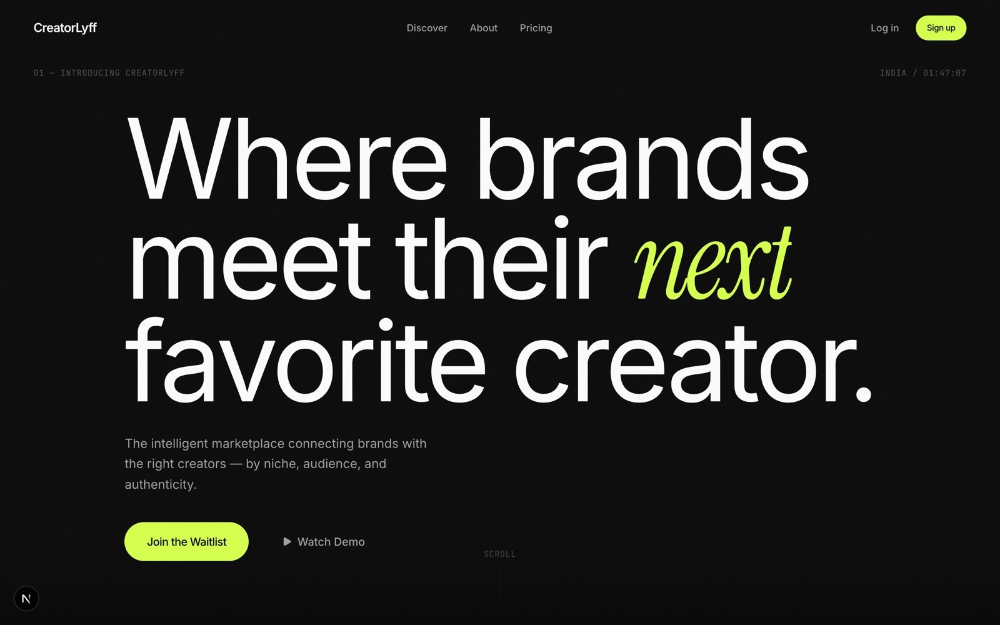
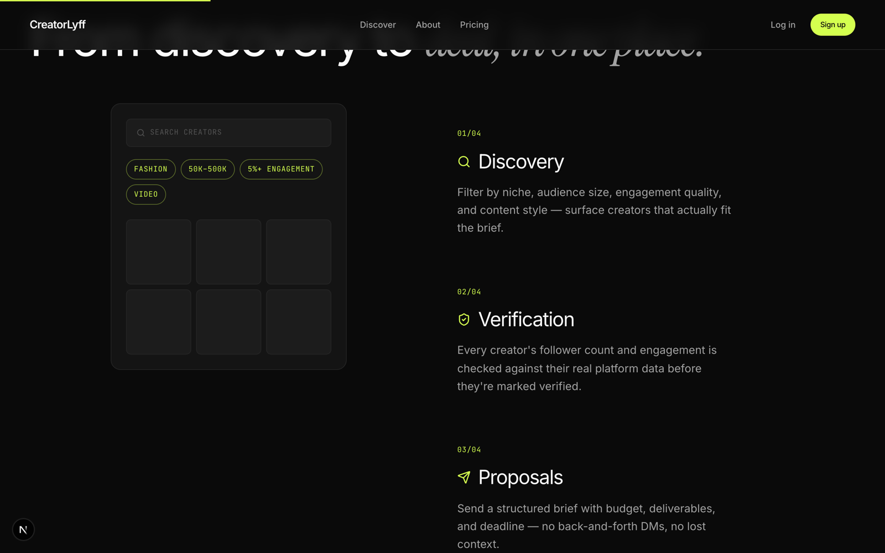
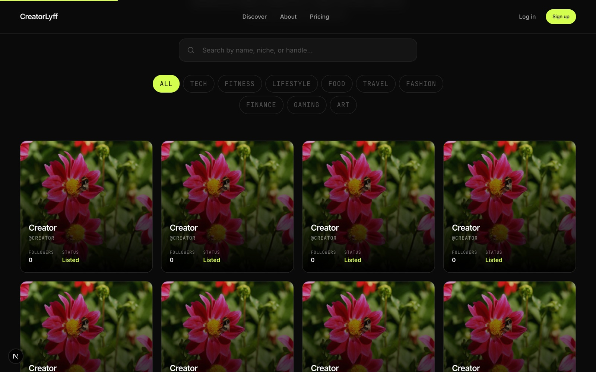
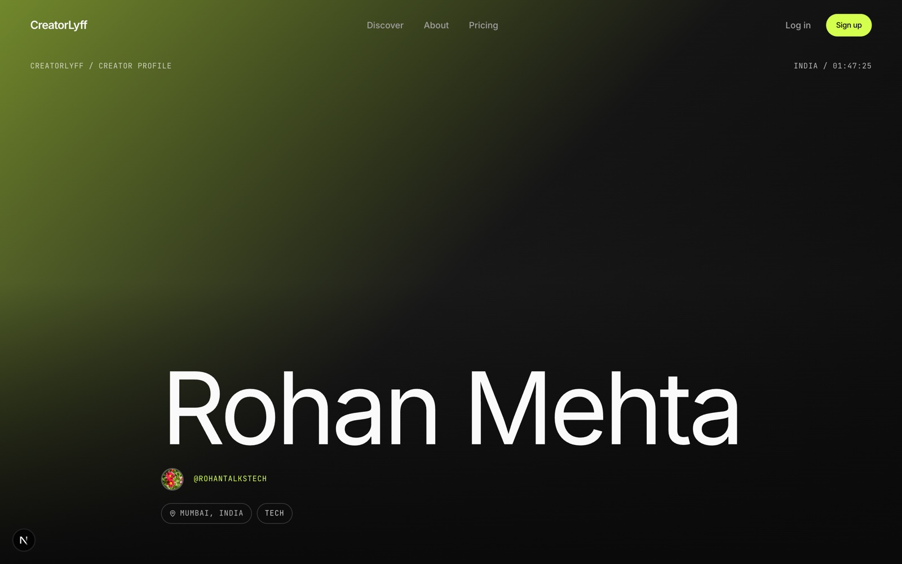
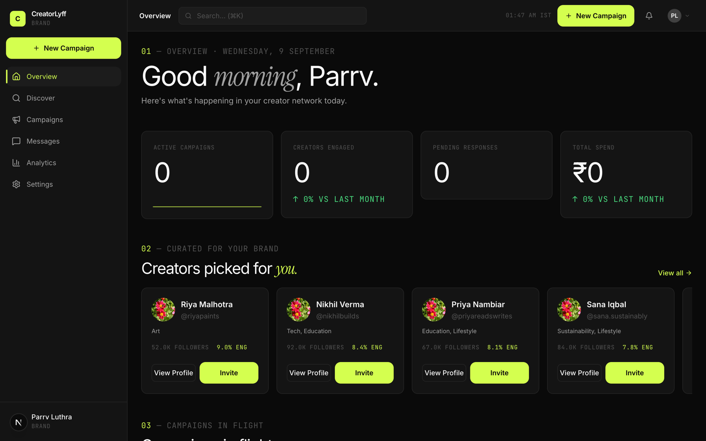
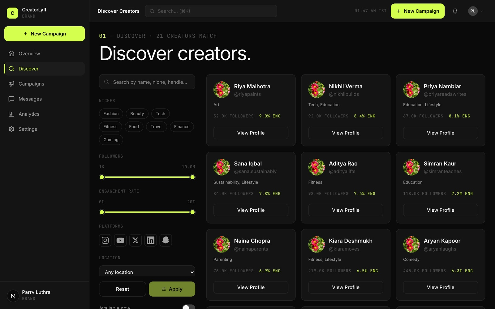
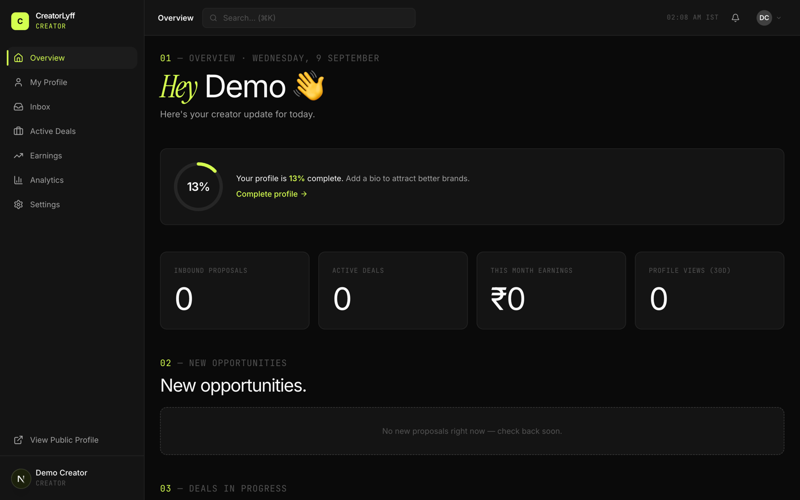
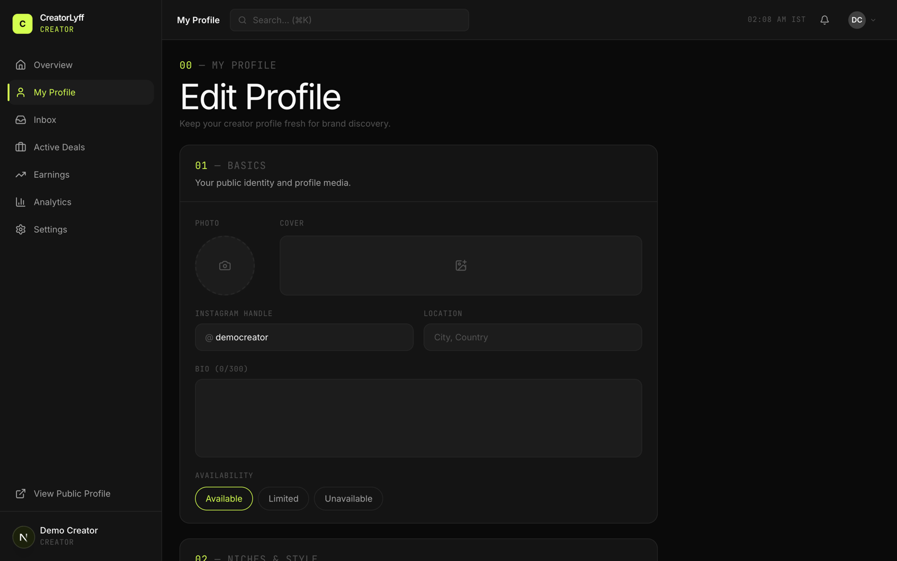
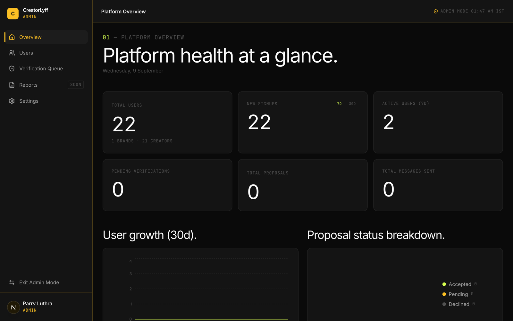
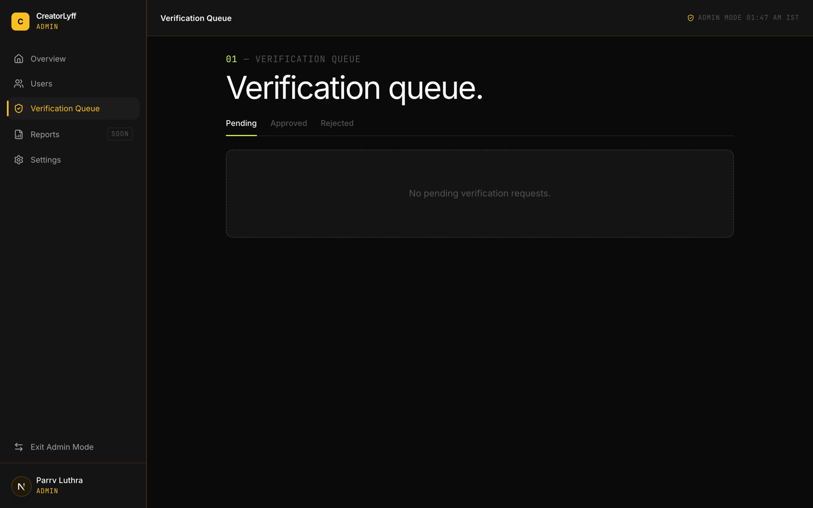

# CreatorLyff

**The intelligent marketplace connecting brands with the right creators — by niche, audience, and authenticity. No more cold DMs.**



---

## The idea

Brands looking for creators to work with are stuck between two bad options: cold-DMing influencers and hoping for a reply, or paying an agency a markup to do the same thing manually. Creators, meanwhile, spend more time chasing brand deals in their inbox than actually creating.

**CreatorLyff** is a two-sided marketplace that fixes both sides of that problem:

- **Brands** search a filterable directory of creators (niche, audience size, engagement, platform), send a structured proposal with a real budget and deadline instead of a DM, and manage the whole relationship — chat, deal stages, payment status — from one dashboard.
- **Creators** get a public portfolio profile that looks like a personal site instead of a database row, receive inbound proposals instead of chasing them, verify their real follower/engagement numbers by connecting their actual social accounts (not self-reported), and track every deal from "pending" to "paid" in one place.
- **Admins** run the trust layer underneath both sides: reviewing verification requests, managing users, and watching platform health.

It's built as a full-stack, production-shaped app — real auth, a real database, real-time messaging, OAuth integrations with six platforms, and a fully custom dark/lime design system with the kind of motion/interaction polish you'd expect from a funded startup's marketing site, not a bootcamp project.

## Screenshots

<table>
<tr>
<td width="50%">

**Landing page**


</td>
<td width="50%">

**How it works**


</td>
</tr>
<tr>
<td width="50%">

**Discover creators**


</td>
<td width="50%">

**Public creator profile**


</td>
</tr>
<tr>
<td width="50%">

**Brand dashboard**


</td>
<td width="50%">

**Brand → unlocked creator discovery**


</td>
</tr>
<tr>
<td width="50%">

**Creator dashboard**


</td>
<td width="50%">

**Creator profile editor**


</td>
</tr>
<tr>
<td width="50%">

**Admin — platform overview**


</td>
<td width="50%">

**Admin — verification queue**


</td>
</tr>
</table>

All screenshots above are of the actual running app — a live local backend, a seeded MongoDB database with 20 mock creators and a real signed-up brand/creator/admin account, not mockups.

## Core features

### Public / marketing site
- Editorial, animated landing page — full-viewport WebGL shader hero, scroll-driven "How It Works" section, brand marquee, niche explorer, bento feature grid, horizontally-scrollable creator showcase, testimonials, animated stat counters
- **Discover** — public creator directory with niche/follower/engagement filters; card data unlocks fully once you're signed in as a brand
- **Public creator profiles** (`/c/[handle]`) — a full portfolio page per creator: parallax cover hero, real computed stats (combined followers, engagement rate, avg. views, 30-day profile views), platform cards, a masonry showcase with a lightbox (images, video, embedded YouTube), public rate cards, a "trusted by" logo wall sourced from real accepted deals, and a "Send Proposal" CTA that routes brands straight into a pre-filled campaign
- Dynamic SEO metadata + Person JSON-LD schema per creator profile, sitemap, robots.txt
- Pricing, About, and five real legal pages (privacy, terms, refund, delivery, data deletion)

### Authentication & onboarding
- Email/password auth with JWT httpOnly cookies, bcrypt hashing, rate limiting
- OAuth login/connect for **Google, Instagram, YouTube, X (Twitter), LinkedIn, and Snapchat**
- Forgot/reset password flow, email verification
- Role-aware onboarding (Brand vs. Creator) that collects the minimum needed to land in a working dashboard on day one

### Brand dashboard
- **Overview** — live stats, creators curated for the brand's niches, campaigns in flight
- **Discover** — the full unlocked creator directory with real filters and an "Invite" flow
- **Campaigns** — a 5-step campaign creation modal (brief → deliverables → budget → creator selection → review), a campaign list with status/progress, and a campaign detail page
- **Creators** — CRM-style view of every creator the brand has worked with
- **Messages** — real-time chat per active deal
- **Proposals**, **Analytics**, **Profile**, **Settings** (account, password, notification preferences)

### Creator dashboard
- **Overview** — profile-completion meter, inbound proposal count, active deals, this-month earnings, 30-day profile views
- **Inbox** — accept / decline / negotiate on inbound proposals via a detail drawer
- **Active Deals** — every accepted proposal tracked through real deal stages (brief → content creation → review → approved → posted → paid)
- **Earnings** — payment history per deal
- **Profile editor** — bio, niches, pricing (with an "open to negotiation" toggle), portfolio uploads, and per-platform connection cards (Instagram, YouTube, X, LinkedIn, Snapchat) that pull real follower/engagement data via OAuth
- **Verification** — request a verified badge by uploading evidence; reviewed by an admin
- **Messages**, **Analytics**, **Settings**

### Admin dashboard
- Route-protected (`isAdmin` flag, granted only via a seed script — never through the UI)
- **Overview** — total users, new signups, active users, pending verifications, proposal/message volume, a 30-day growth chart
- **Users** — searchable/filterable list with suspend, unsuspend, and delete, each gated behind a typed-confirmation modal
- **Verification queue** — the core trust workflow: review submitted evidence, approve with a badge tier or reject with a reason sent back to the creator
- **Reports** (flagged "Soon" — the one deliberately unbuilt page) and **Settings**

### Real-time & notifications
- Socket.io-backed chat, with typing indicators and delivery state
- A notification model + center covering new proposals, messages, and verification decisions, with a live unread badge
- Transactional email (proposal received/accepted/declined, verification decisions) via Resend — degrades to a no-op log if unconfigured

### Design system & interaction polish
- Dark (`#0a0a0a`) + lime (`#d4ff4f`) visual identity, enforced via CSS custom properties everywhere — no hard-coded colors
- Framer Motion page-transition sweep, a first-visit loading sequence, a custom magnetic cursor (context-aware labels: "OPEN" on external links, "DRAG" on horizontally-scrollable regions, a hover magnetize effect toward buttons) that respects `prefers-reduced-motion` and hides on touch devices
- Instagram/TikTok-style bottom tab bar on mobile dashboards, full keyboard/`Escape` support and `role="dialog"` semantics on every modal
- A hidden Konami-code easter egg (confetti + a tracked analytics event, because why not)

### Platform integrity
- Verification pipeline backed by real OAuth-sourced platform data, not self-reported numbers
- Rate limiting tuned per endpoint (auth, proposal creation, uploads, verification requests)
- Product analytics via PostHog (frontend + backend), safe no-op when unconfigured
- Payments (Razorpay) integrated but intentionally left disabled — CreatorLyff is in a free beta phase; pricing/plan data already matches what ships once billing turns on

## Architecture

```
creatorsync2/
├── frontend/                 Next.js 16 (App Router) + React 19 + TypeScript
│   ├── app/                  Routes — public pages, dashboards, legal, auth
│   │   ├── dashboard/brand/  Brand dashboard route group
│   │   ├── dashboard/creator/  Creator dashboard route group
│   │   ├── dashboard/admin/  Admin dashboard route group
│   │   └── c/[handle]/       Public creator profile (server component + metadata)
│   ├── components/           UI, section, and dashboard components
│   │   ├── sections/         Landing page sections
│   │   ├── dashboard/        Shared dashboard chrome (sidebars, modals, toasts)
│   │   ├── admin/            Admin-only components
│   │   └── three/            WebGL/shader components (code-split, ssr:false)
│   └── lib/                  API client, Zustand auth store, TanStack Query hooks
│
├── backend/                  Node.js + Express + TypeScript
│   └── src/
│       ├── routes/           auth, profile, proposals, chat, uploads, admin,
│       │                     verification, activity, notifications, instagram,
│       │                     youtube, payments (mounted but disabled)
│       ├── models/           User, CreatorProfile, BrandProfile, Proposal,
│       │                     Conversation, Message, Notification,
│       │                     VerificationRequest, Payment
│       ├── middleware/       JWT auth, admin/cron-secret auth, rate limiting
│       ├── services/         Instagram/YouTube data sync, notification center
│       ├── jobs/             Daily social-stats re-sync (node-cron)
│       └── socket.ts         Socket.io real-time chat + notification push
│
└── docs/screenshots/         The images in this README
```

**Frontend:** Next.js 16 (App Router, Turbopack), React 19, TypeScript, Tailwind CSS v4 (CSS-variable design tokens, no config file), Zustand, TanStack Query 5, Framer Motion, GSAP, Lenis (smooth scroll, disabled on dashboards), `@react-three/fiber` + Three.js (hero shader), Recharts, Socket.io client.

**Backend:** Express, TypeScript, MongoDB + Mongoose, JWT (httpOnly cookies), Passport (Google/Instagram/YouTube/Twitter/LinkedIn/Snapchat OAuth), bcrypt, Socket.io, node-cron, Cloudinary (uploads, with local-disk fallback), Resend (email), PostHog (analytics), Razorpay (integrated, disabled).

**Data flow, at a glance:** the frontend never talks to MongoDB directly — every request goes through the Express API, which is the single source of truth for auth (JWT cookie, verified per-request), authorization (role checks + a separate `isAdmin` flag), and rate limiting. Real-time events (new message, new proposal, verification decision) are pushed over the same Socket.io connection the chat UI already holds, and land in the notification center without a page refresh. Social platform data (followers, engagement, recent posts) is pulled once via OAuth, cached on the creator's profile document, and refreshed by a daily cron job — the numbers a brand sees are never live-fetched from Instagram/YouTube on page load.

## Getting started

### Prerequisites
- Node.js 20+
- MongoDB running locally, or a connection string (e.g. MongoDB Atlas)

### Installation

```bash
npm run install:all
```

### Environment variables

```bash
cp backend/.env.example backend/.env
```

`backend/.env.example` documents every variable the backend reads, with a comment explaining what each is for. At minimum, set `MONGODB_URI` and `JWT_SECRET` — everything else (Cloudinary, Resend, PostHog, each OAuth provider, Razorpay) degrades gracefully when unset.

Create `frontend/.env.local`:
```
NEXT_PUBLIC_API_URL=http://localhost:5001
```

### Run it

```bash
mongod
npm run dev
```

This starts both the frontend (`:3000`) and backend (`:5001`) concurrently.

### Seed data (optional, recommended)

```bash
cd backend
npm run seed:mock-creators   # 20 realistic mock creator profiles
npm run seed:admin           # grants admin access to accounts listed in ADMIN_EMAILS
```

`/dashboard/admin/setup` in the running app documents the same admin-seeding steps with copyable commands.

## API overview

All routes are mounted under `/api` on the backend. Full request/response shapes live in the route files under `backend/src/routes/`.

| Resource | Base path | Covers |
|---|---|---|
| Auth | `/api/auth` | signup, login, logout, `/me`, password reset, email verification, OAuth callbacks |
| Profile | `/api/profile` | brand/creator profile CRUD, public creator directory, public creator-by-handle |
| Proposals | `/api/proposals` | create, list, accept/decline, deal-stage updates |
| Chat | `/api/chat` | conversations, message history, attachment uploads |
| Uploads | `/api/uploads` | Cloudinary (or local-disk) file uploads |
| Verification | `/api/verification` | request, approve, reject, auto-flag cron endpoint |
| Notifications | `/api/notifications` | list, mark-read |
| Activity | `/api/activity` | unified activity feed (proposals, messages, verification) |
| Admin | `/api/admin` | user management, platform stats, verification queue |
| Instagram / YouTube | `/api/instagram`, `/api/youtube` | OAuth connect + data sync |

## Security

- Password hashing with bcrypt
- JWT in httpOnly, `SameSite` cookies (no tokens in localStorage)
- Per-endpoint rate limiting (auth, proposal creation, uploads, verification requests)
- Helmet security headers, strict CORS allow-list
- Admin routes gated by an explicit `isAdmin` flag, granted only via a seed script

## License

MIT
